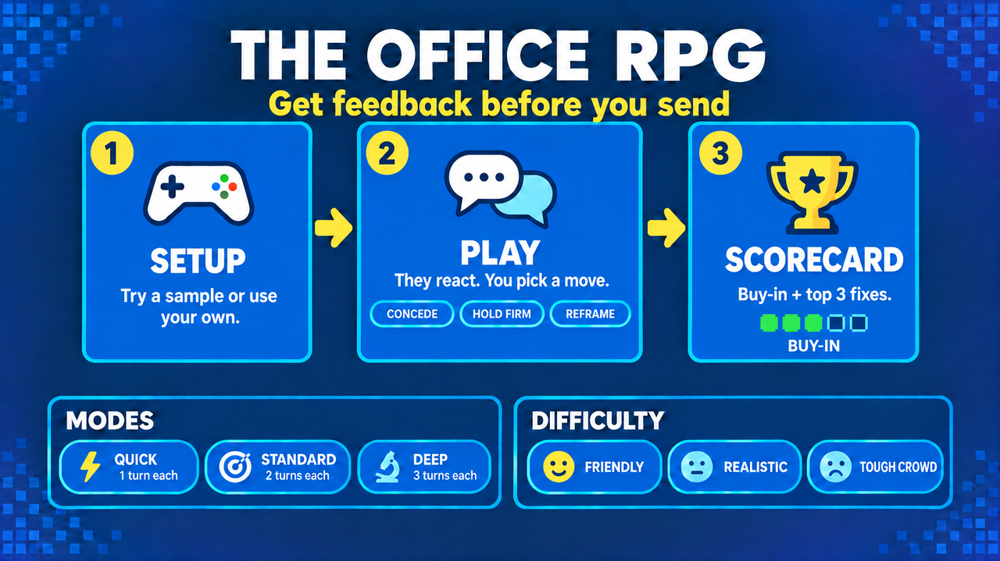

# To Be Creative

**I use AI to create, not save time.**

This repo holds the skills and prompts from my LinkedIn newsletter, [To Be Creative](https://www.linkedin.com/newsletters/to-be-creative-7447669265270448130/). Take them, use them, make them yours.

### [⬇️ Download The Office RPG](https://github.com/fedepacheco/tbc/raw/main/skills/the-office-rpg/the-office-rpg.zip)

## What's here

| | Skill | What it does | Get it |
|---|---|---|---|
|  | 🎮 **[The Office RPG](skills/the-office-rpg)** | Get feedback before you send. Predict how people will react, then fix it. | [⬇️ Download](https://github.com/fedepacheco/tbc/raw/main/skills/the-office-rpg/the-office-rpg.zip) |

More is coming in December with **12 Days of Creativity**.

## Install a skill in Copilot Cowork

1. Click the **⬇️ Download** link for the skill. A `.zip` file lands in your Downloads.
2. In Cowork, go to **Customize > Plugins**, open the **Cowork** tab, then **Add > Upload**, and pick the `.zip`.
3. Start a new chat and use the trigger phrase on the skill's page.

## FAQ

**Do I need to know GitHub?**
No. You only need the download link.

**Do I need a GitHub account?**
No, not to download. You only need one to open an Issue.

**What is a skill?**
A set of instructions Copilot follows for one specific job. It's a folder with a `SKILL.md` file, written in plain English. Open it and read it.

**What do I need to run it?**
Access to Copilot Cowork in Microsoft 365.

**Does it work in other AI tools?**
I build and test everything in Copilot Cowork. Other assistants that support skill files may load it, but I haven't tested them.

**Can I change it?**
Yes. It's MIT licensed. Edit `SKILL.md`, zip the folder again and upload it.

**Found a bug or have an idea?**
Open an Issue in this repo or message me on LinkedIn.

---
I work at Microsoft. The skills and opinions here are my own.
