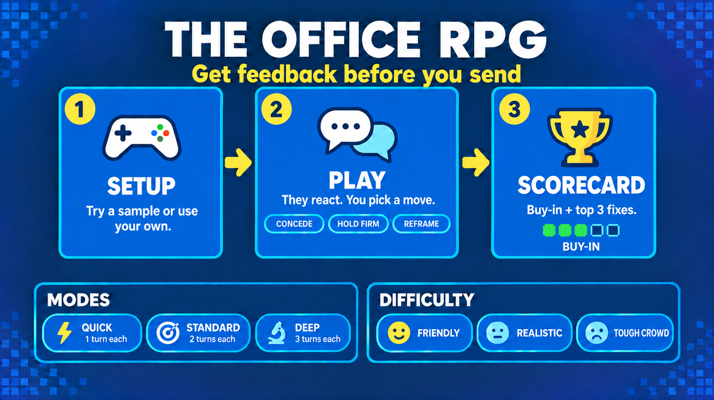

# 🎮 The Office RPG

**Get feedback before you send.**

## [⬇️ Download The Office RPG](https://github.com/fedepacheco/tbc/raw/main/skills/the-office-rpg/the-office-rpg.zip)

Bring an email, doc or deck. The skill predicts how up to three people will react, lets you play out a short back-and-forth, and ends with a scorecard and the exact edits to make.

## Install in 2 minutes

1. Click the **⬇️ Download** link above. `the-office-rpg.zip` lands in your Downloads.
2. In Copilot Cowork, go to **Customize > Plugins**, open the **Cowork** tab, then **Add > Upload**, and pick the file.
3. Start a new chat and type `try the office RPG`.

## How it plays

1. 🎮 **Setup:** try a sample or use your own email, doc or deck. Pick your turns (Quick, Standard, Deep) and your crowd (Friendly, Realistic, Tough crowd).
2. 💬 **Play:** up to 3 people react, each reply labeled *predicted*. You pick a move: Concede, Hold firm or Reframe.
3. 🏆 **Scorecard:** buy-in per person and the top 3 fixes, quoting the exact line to change. It can apply them as an Outlook draft or a tracked-changes copy.

**First time?** Pick **Try a sample**. You get a $40K budget ask and three fictional characters: Priya (the approver), Marc (the one who does the work) and Michael (the wildcard).

**Your own content?** Attach a file or paste a message and type `play the office RPG` or `stress-test this before I send it`.

| Turns | What you get |
|---|---|
| ⚡ Quick | 1 turn each |
| 🎯 Standard | 2 turns each, uses 2 weeks of context |
| 🔬 Deep | 3 turns each, plus one recent meeting transcript |

## What it reads

- **Sample game:** nothing.
- **Real people:** your recent emails, chats and meetings with them, only to predict their work reaction. Deep mode also reads one relevant meeting transcript.
- **It never sends anything.** Every reply is labeled *predicted*. Applying fixes creates an Outlook draft or a tracked-changes copy.
- It sticks to professional reactions: budget, risk, scope, timeline. No performance judgments, no personal profiling.

## Files

| File | What it is |
|---|---|
| [`the-office-rpg.zip`](https://github.com/fedepacheco/tbc/raw/main/skills/the-office-rpg/the-office-rpg.zip) | Download this one to install |
| [`SKILL.md`](SKILL.md) | The instructions Copilot follows, readable |
| [`references/`](references) | The demo cast, the sample scenario and an example game |
| [`assets/`](assets) | The how-it-works guide |

Version 3.4 · MIT license · by Fede Pacheco · the story behind it is in [To Be Creative](https://www.linkedin.com/newsletters/to-be-creative-7447669265270448130/)

---
I work at Microsoft. The skills and opinions here are my own.
